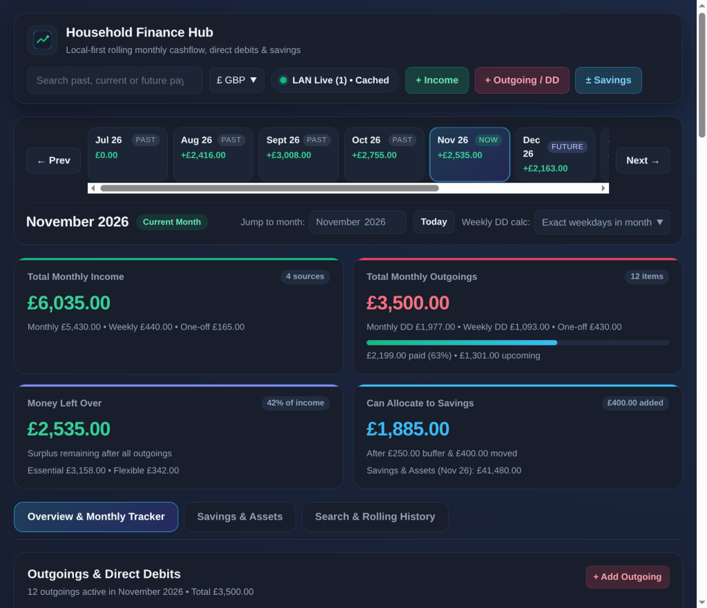
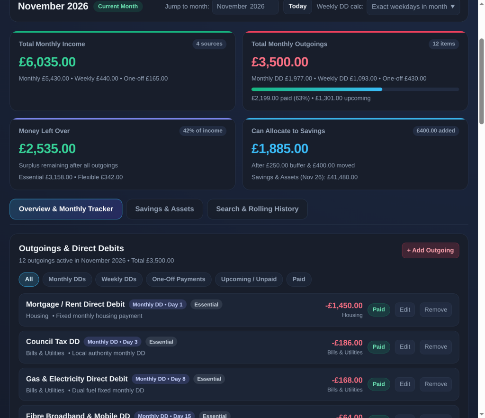
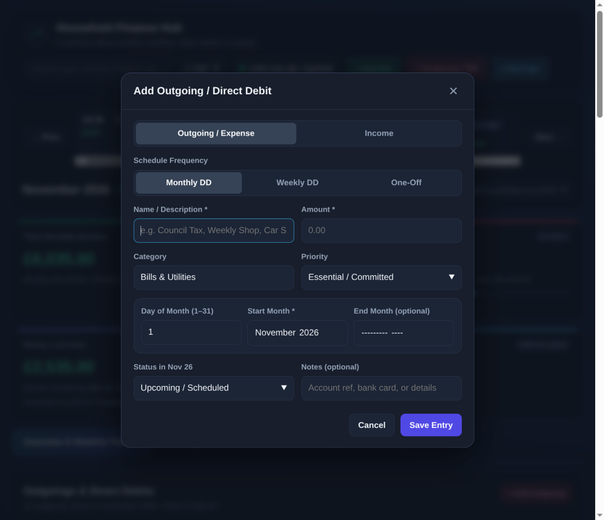
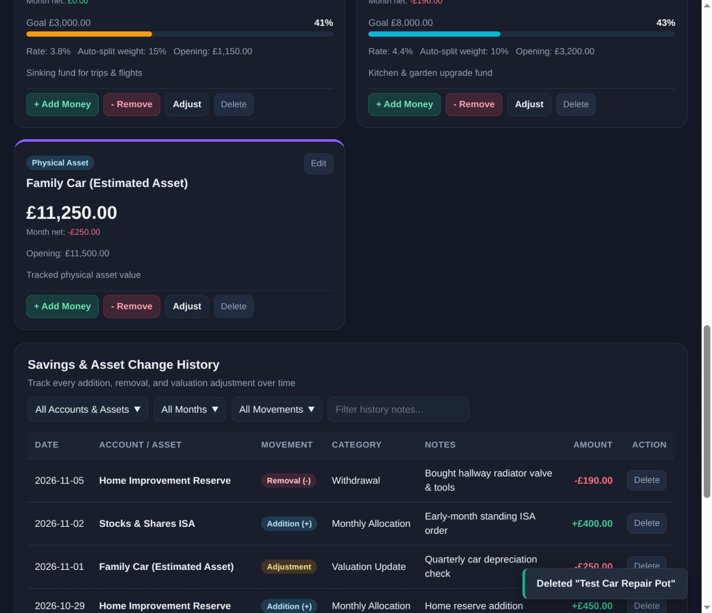
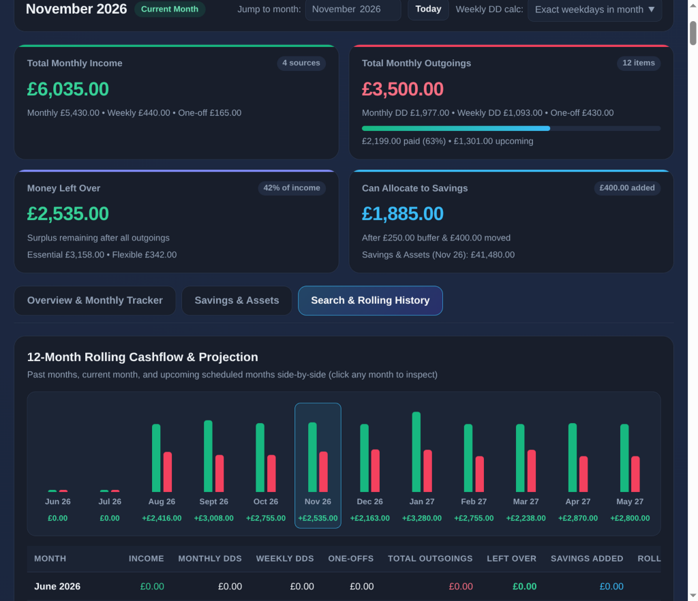
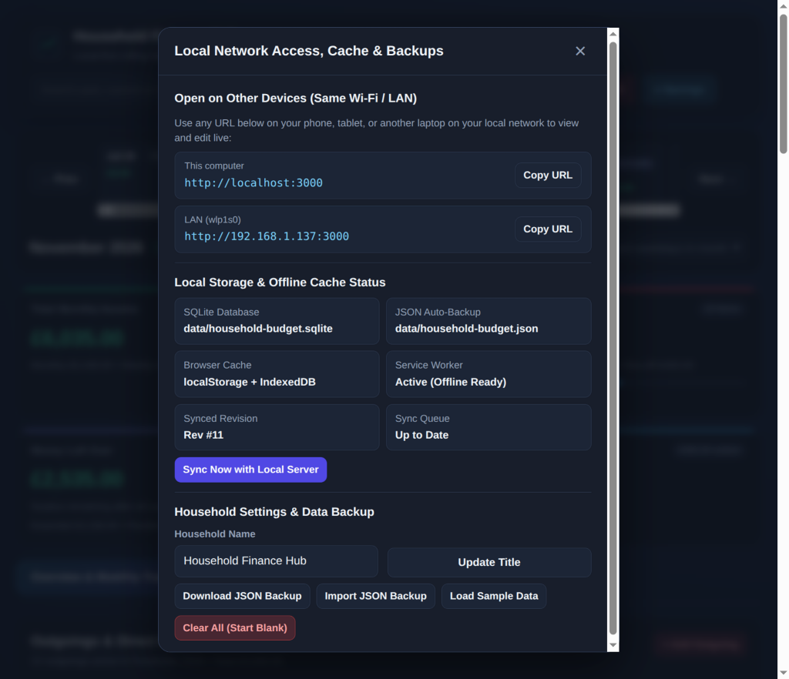

# Household Finance Hub

A **local-first, self-hosted rolling monthly income, outgoings, direct debits, and savings/assets tracker** built with zero external npm dependencies (Node.js v24 + built-in `node:sqlite`). Designed to keep all financial data stored locally on your server while allowing instant viewing and editing from any phone, tablet, or computer on your local network or via Docker on port **`5025`**.

---

## Highlights

- **100% Local Persistence:** Stores state and revision snapshots in SQLite (`data/household-budget.sqlite`) with automatic mirrored JSON backups (`data/household-budget.json`).
- **Offline-Resilient Client Caching:** Caches state locally in `localStorage`, `IndexedDB`, and a Service Worker (`sw.js`) so the interface loads instantaneously and queues edits when temporarily disconnected.
- **Multi-Device LAN & Remote Sync:** Real-time Server-Sent Events (`GET /api/events`) keep every connected browser tab and mobile device synchronized automatically.
- **Rolling Monthly Engine:** Seamlessly browse past saved months, the current month, and future scheduled months side-by-side—with weekly direct debits, monthly direct debits, one-off payments, and full savings/asset tracking.
- **Zero-Dependency Docker Image:** Runs cleanly on `node:24-alpine` exposed on port `5025` with persistent `/app/data` volume storage.

---

## Screenshots

### 1. Monthly Overview & Rolling Navigator
Track total monthly income, total outgoings (with paid vs. upcoming progress), money left over, and savings allocation at a glance across a 9-month rolling pill strip.



### 2. Outgoings, Weekly/Monthly Direct Debits & Incomes
Filter by Monthly Direct Debits, Weekly Direct Debits (showing exact weekday occurrence counts like `4×` or `5×` and dates in the month), One-Off Payments, Paid, or Upcoming—with one-click status toggles, per-month overrides, and clean removal controls.



### 3. Add / Edit Incomes, Direct Debits & One-Off Payments
Switch effortlessly between Monthly DD, Weekly DD, and One-Off schedules, choose Essential vs. Flexible priority, and edit either an entire recurring series or just the currently selected month.



### 4. Savings Accounts, Assets & Change History
Manage savings pots, ISAs, investments, cash pots, and physical assets with goal progress bars, `+ Add Money`, `- Remove`, and `Adjust (+/-)` movements, plus a full filterable change history ledger.



### 5. 12-Month Rolling Projection & Global Search
Compare 12 past, current, and upcoming months side-by-side in an interactive bar chart and table, and search across all past, current, and future payments, incomes, and savings changes.



### 6. Local Network Access, Offline Cache & Backups
Copy direct LAN/remote URLs for phones and tablets, inspect SQLite/JSON/browser cache sync status, export or restore JSON backups, and reload sample data or start blank.



---

## Complete Feature List

### 1. Rolling Monthly Cashflow Tracking
- **Interactive Rolling Navigator:** Step backward and forward with `< Prev` / `Next >`, click any month in the 9-month rolling pill strip (4 past months, active month, 4 future months with net surplus previews), jump to any historical or future month via the month picker, or snap back with `Today`.
- **Headline Executive KPI Cards:**
  - **Total Monthly Income** (broken down by Monthly, Weekly, and One-Off sources)
  - **Total Monthly Outgoings** (Monthly DD, Weekly DD, One-Off totals, plus a Paid vs. Upcoming progress bar)
  - **Money Left Over** (net surplus/deficit, `% of income` remaining, and Essential vs. Flexible spending split)
  - **Available for Savings & Net Worth** (remaining unallocated surplus after your safety buffer and logged monthly transfers, plus total savings & assets through the selected month)
- **Multi-Currency Display:** Switch cleanly between `£ GBP`, `$ USD`, and `€ EUR`.

### 2. Incomes, Outgoings & Direct Debits Management
- **Three Payment & Income Schedules:**
  - **Monthly Direct Debits:** Recurring monthly items with configurable day-of-month, start month, and optional end month.
  - **Weekly Direct Debits:** Recurring weekly items by weekday (`Monday`–`Sunday`) with three transparent calculation modes:
    - *Exact weekdays in month* (counts actual occurrences and lists the exact dates in that calendar month, e.g., 4 vs. 5 Fridays)
    - *Fixed 4 weeks (`×4`)*
    - *Monthly average (`×52÷12`)*
  - **One-Off Payments & Incomes:** Scheduled for any past, current, or future month with optional exact date.
- **Per-Month Overrides & Non-Destructive Stopping:**
  - Edit a recurring direct debit across all active months **or** override the amount/notes for a single month only.
  - Remove a recurring direct debit by choosing **"Stop from this month onwards (keep past history)"** or **"Delete completely from all months"**.
- **One-Click Status Cycling:** Toggle any item between `Paid / Received`, `Upcoming`, and `Skipped` for the viewed month.

### 3. Outgoings Visual Breakdown & Interactive Savings Allocator
- **Outgoings Breakdown Sidebar:** Visual stacked bar comparing Monthly DDs, Weekly DDs, and One-Offs alongside category-by-category progress bars.
- **Interactive Savings Allocator:**
  - Calculates **Remaining Available to Allocate** from `Money Left Over - Current Account Safety Buffer - Savings Already Added This Month`.
  - Auto-split leftover cash across your savings accounts using customizable allocation weights (or enter manual amounts per account).
  - Click **Transfer Planned Allocation to Savings** to log dated deposit entries straight into your savings ledger.

### 4. Savings Accounts & Assets Tracker
- **Track Cash & Physical Assets Together:** Supports `Savings Account`, `ISA / Tax-Free Savings`, `Investment / Shares`, `Cash / Sinking Pot`, and `Physical Asset / Property`.
- **Per-Account Insights:** Displays balance as of the selected month, live balance today, monthly net change, goal target progress bar, interest/growth rate, and allocation weight.
- **Balance Change Actions:** Record **`+ Add Money`** (deposits), **`- Remove Money`** (withdrawals), and **`Adjust (+/-)`** (interest, dividends, or asset valuation updates).
- **Savings & Asset Change History:** Filterable chronological ledger by account, month scope (`All Months` vs. `Selected Month Only`), movement type, and search notes.

### 5. 12-Month Rolling Projection & Global Search Explorer
- **12-Month Rolling Chart & Cashflow Table:** Side-by-side comparison spanning 5 months back through 6 months ahead (`Income`, `Monthly DDs`, `Weekly DDs`, `One-Offs`, `Total Outgoings`, `Left Over`, `Savings Added`, `Rolling Cash Carry`, and `Total Savings & Assets`). Clicking any month opens it directly.
- **Global Search Across All Past, Current & Future Payments:**
  - Full-text search across names, categories, notes, dates, and accounts.
  - Filter by **Time Window** (`All Months`, `Past Months Only`, `Current Month Only`, `Future Payments Only`, or a custom `From`–`To` month range), **Record Type** (`Outgoings`, `Incomes`, `Savings & Asset Changes`), **Frequency**, **Category**, and **Status**.
  - Click **Open Month** on any search result to jump directly to that month.

### 6. Local-First Storage, Offline Caching & Real-Time LAN Sync
- **Server Persistence:** SQLite database (`node:sqlite` with WAL mode and up to 30 revision snapshots) mirrored on every write to a human-readable JSON backup file.
- **Browser Offline Cache:** Automatic dual-layer caching in `localStorage` (`hb_state_cache_v1`) and `IndexedDB` (`HouseholdBudgetLocalDB`), plus Service Worker (`sw.js`) asset caching and PWA `manifest.json`.
- **Offline Edit Queue:** Changes made while offline are saved immediately in the browser and automatically pushed to the server when connectivity returns.
- **Real-Time Multi-Device Sync:** Server-Sent Events (`GET /api/events`) push updates across all open tabs and LAN devices whenever any user makes a change.
- **Backup & Restore:** Download full JSON backups (`GET /api/export`), import/restore backups from disk, reload seeded sample data, or clear everything to start blank.

---

## Run as a Docker Container (Port 5025)

### Option 1: Docker Compose (Recommended)

Clone or copy the repository to your server and run:

```bash
docker compose up -d --build
```

This builds the `node:24-alpine` container (`Dockerfile`), exposes port **`5025`** (`0.0.0.0:5025`), enables automatic restarts (`restart: unless-stopped`), runs health checks against `/api/health`, and mounts `./data:/app/data` so your SQLite database and JSON backups persist on the host.

Useful management commands:

```bash
docker compose logs -f
docker compose down
```

### Option 2: Standalone `docker build` and `docker run`

```bash
docker build -t household-finance-hub .

docker run -d \
  --name household-finance-hub \
  --restart unless-stopped \
  -p 5025:5025 \
  -v "$(pwd)/data:/app/data" \
  household-finance-hub
```

### Accessing Remotely

Open from any browser or mobile device on your network:

```text
http://<your-server-ip>:5025
```

### Environment Variables

| Variable | Default (Docker) | Default (Local Node) | Purpose |
| :--- | :--- | :--- | :--- |
| `PORT` | `5025` | `3000` | HTTP server port |
| `HOST` | `0.0.0.0` | `0.0.0.0` | Bind address |
| `DATA_DIR` | `/app/data` | `./data` | Directory for `household-budget.sqlite` and `household-budget.json` |
| `HOST_IP` | — | — | Optional remote host IP to show in the LAN/Remote Access modal |
| `PUBLIC_URL` | — | — | Optional full remote URL (e.g., `http://my-server.local:5025`) to display in the UI |

---

## Run Directly Without Docker

Requires **Node.js >= 22.5** (built and tested on **Node.js v24** with zero external dependencies):

```bash
# Start on default port 3000 (or specify PORT=5025)
npm start

# Or specify custom port and data directory
PORT=5025 DATA_DIR=./data node server.js
```

Run the automated test & persistence verification suite:

```bash
npm test
```

---

## API Reference

| Method & Endpoint | Description |
| :--- | :--- |
| `GET /api/health` | Health check returning status, current revision, timestamp, and network URLs |
| `GET /api/network-info` | Returns local URL, detected LAN/remote URLs, and storage file paths |
| `GET /api/state` | Returns full household budget state, revision metadata, and network info |
| `PUT /api/state` | Validates and saves updated state to SQLite + JSON backup, then broadcasts SSE update |
| `POST /api/reset` | Resets state (`{ mode: "sample" \| "empty" }`) |
| `GET /api/export` | Downloads a timestamped JSON backup file |
| `GET /api/events` | Server-Sent Events stream for real-time cross-device updates |

---

## Project Structure

```text
.
├── Dockerfile               # node:24-alpine image exposed on port 5025
├── docker-compose.yml       # Compose service with ./data:/app/data persistence
├── .dockerignore            # Excludes local data files, tests, and docs from Docker context
├── .gitignore               # Excludes runtime SQLite/JSON data files from Git
├── package.json             # Scripts (start, test) and engine requirement (>=22.5.0)
├── server.js                # Built-in HTTP server, node:sqlite store, JSON backup & SSE sync
├── seed-data.js             # Initial sample data generator (past, current, and future months)
├── public/
│   ├── index.html           # Main dashboard, tabs, and interactive modals
│   ├── styles.css           # Responsive dark-slate financial UI styling
│   ├── app.js               # Rolling month engine, CRUD, savings allocator, search & local cache
│   ├── sw.js                # Service Worker for offline shell caching
│   ├── manifest.json        # PWA manifest
│   └── icon.svg             # App icon
├── test/
│   └── verify.js            # Automated API, persistence, Docker config & port 5025 test suite
└── docs/
    └── screenshots/         # UI screenshots displayed in README
```
